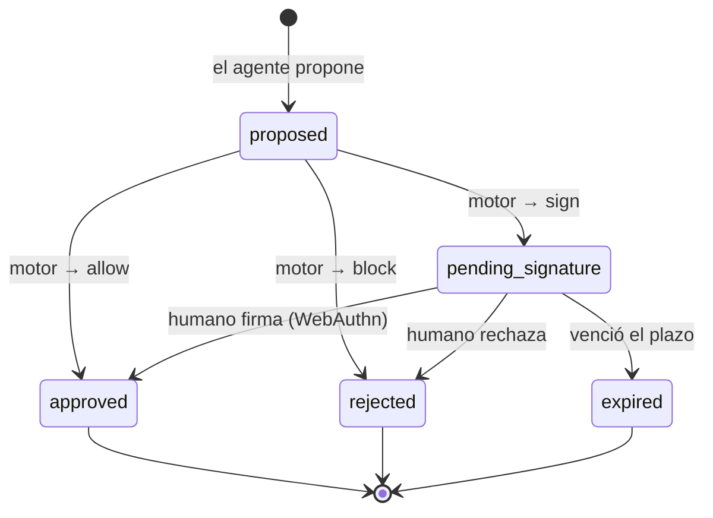

# Fase 1 — El modelo de datos

> Implementación: [`src/domain/action.ts`](../src/domain/action.ts). Sin servidor: solo tipos, validación y máquina de estados.

## ¿Qué es una acción?

Todo lo que un agente de IA propone hacer sobre el dinero o los datos de la empresa.

### Tipos de acción

| Tipo | Significado | Ejemplo |
|---|---|---|
| `payment` | Pago a un proveedor | "Paga 250,00 EUR a amazon.es por material de oficina" |
| `reservation` | Reserva con coste | "Reserva hotel por 120,00 EUR para la feria" |
| `loan` | Solicitud de crédito | "Pide 5.000,00 EUR de línea de crédito" |
| `data_access` | Lectura de datos | "Lee dataset:clientes-pii para el informe mensual" |

### Campos

| Campo | Tipo | Descripción |
|---|---|---|
| `id` | string (UUID) | Identidad única de la acción |
| `agentId` | string | Agente o sistema que la propone |
| `actionType` | enum | `payment` · `reservation` · `loan` · `data_access` |
| `amountMinor` | int \| ausente | Importe en **unidades menores** (centavos). Ausente en `data_access` |
| `currency` | string | Código ISO 4217 (`EUR`, `USD`, `CHF`…) |
| `destination` | string | Cuenta/IBAN, proveedor, dataset, URL… |
| `justification` | string | Por qué el agente la necesita; la lee el humano que firma (mínimo 10 caracteres) |
| `metadata` | object \| ausente | Datos extra del agente (id de factura, etc.) |
| `status` | enum | `proposed` · `pending_signature` · `approved` · `rejected` · `expired` |
| `createdAt` / `decidedAt` / `expiresAt` | Date | Cuándo nació, cuándo se decidió, cuándo vence la firma pendiente |
| `decisions` | DecisionRecord[] | Rastro **inmutable** de decisiones (la base de la auditoría) |

## Estados y transiciones

## El rastro de decisiones (DecisionRecord)

Cada acción guarda una lista inmutable de decisiones. Es lo que permitirá demostrar, en la Fase 5, qué pasó y por qué:

| stage | decision | by | ejemplo |
|---|---|---|---|
| `engine` | `allow` / `sign` / `block` | `rules-engine` | "importe 500,00 EUR supera el límite de aprobación automática" |
| `signature` | `approved` / `rejected` / `expired` | id de la llave WebAuthn | firma de María (cred-abc123) |
| `execution` | `approved` / `rejected` | nombre del conector | "conector simulador: ejecución OK" |

## Decisiones de diseño

1. **Dinero en unidades menores (centavos)**: `1234_56` = 1.234,56 EUR. Sin coma flotante, sin errores de redondeo.
2. **`justification` obligatoria y con mínimo**: quien firma debe poder leer *por qué* el agente pide esto.
3. **Máquina de estados pura y exhaustiva**: solo existen las transiciones del diagrama; `canTransition` lo garantiza.
4. **El motor no confía en la validación**: vuelve a comprobar tipo, importe y estado (defensa en profundidad; Fase 7 lo atacará).
5. **Inmutabilidad**: aplicar una decisión devuelve una acción *nueva*; el histórico nunca se reescribe.
