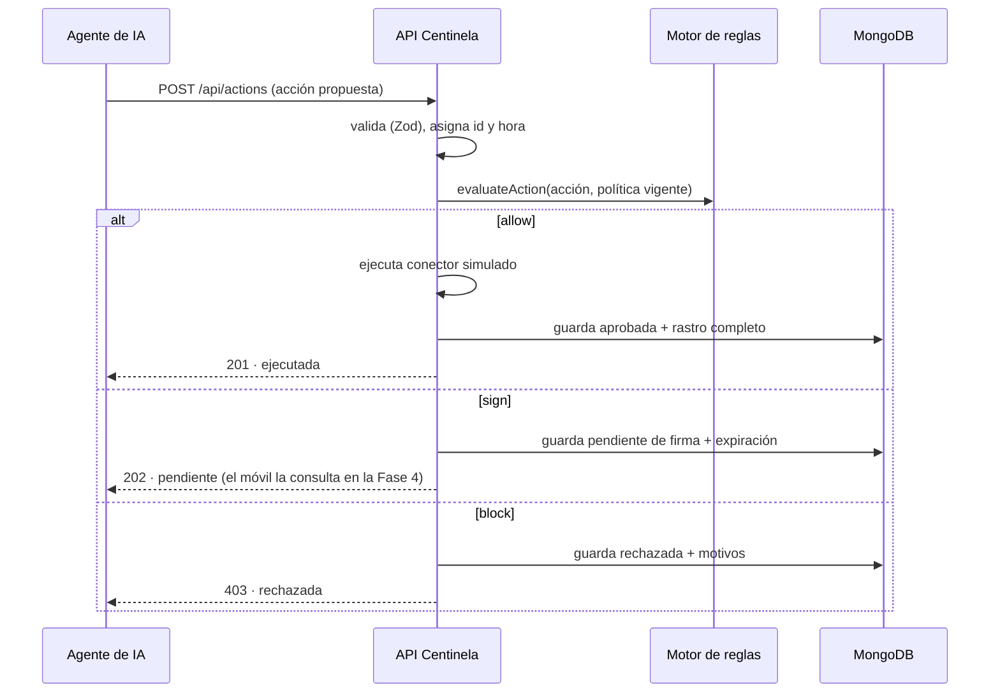

# Fase 3 — El guardián como API

> Implementación: [`src/api/`](../src/api/), [`src/db/`](../src/db/), [`src/execution/`](../src/execution/), [`src/server.ts`](../src/server.ts).

## El flujo de una propuesta



## Endpoints

| Método | Ruta | Qué devuelve |
|---|---|---|
| `POST` | `/api/actions` | 201 allow · 202 sign · 403 block · 400 validación |
| `GET` | `/api/actions/pending` | cola de pendientes de firma (expira las vencidas al leer) |
| `GET` | `/api/actions` | listado con filtros `status`, `agentId`, `actionType`, `limit` |
| `GET` | `/api/actions/:id` | una acción con su rastro completo de decisiones |
| `GET` | `/api/policy` | la política vigente (el panel la editará en la Fase 6) |
| `GET` | `/healthz` | salud del servicio |

## Decisiones de diseño

1. **Todo se guarda, siempre**: incluso los bloqueos (403) quedan persistidos con su motivo. Un bloqueo sin registro no es un bloqueo: es un agujero.
2. **El rastro vive embebido en la acción** (`decisions[]`): la auditoría (Fase 5) lo leerá de ahí; nunca se reescribe.
3. **Idempotencia en dos capas**: el header `Idempotency-Key` es el mecanismo principal (control total: dos acciones idénticas intencionadas usan claves distintas). Sin header, el servidor **deriva la clave del payload + una ventana de tiempo** (60 s por defecto, configurable con `IDEMPOTENCY_WINDOW_SECONDS`): los reintentos dentro de la ventana devuelven la acción original con `replayed: true` y no duplican pagos. Un reintento fuera de la ventana crea otra acción: para reintentos tardíos, la clave explícita es el cierre. El índice único sparse en Mongo hace cumplir la unicidad incluso en envíos paralelos.
4. **Ejecución simulada pero auditada**: los conectores no llaman a bancos reales, pero su resultado (éxito o fallo) queda como `DecisionRecord` de stage `execution`. El destino `proveedor-caido.es` simula un proveedor caído: la acción sigue aprobada y el fallo queda registrado.
5. **Sin TTL index de borrado**: las expiraciones son *cambios de estado* registrados (`expired`), nunca borrados. La auditoría no se tira.
6. **La API depende de interfaces, no de Mongoose**: `ActionRepository` y `PolicyProvider` permiten tests en memoria (`CENTINELA_STORE=mock`) y hacen trivial cambiar de almacén.
7. **Escucha solo en 127.0.0.1**: el guardián no se expone a la red local; los agentes llegarían a través de un proxy autenticado (fuera del alcance del portafolio).

## Arranque

```bash
pnpm dev                       # MongoDB local (mongodb://127.0.0.1:27017/centinela)
CENTINELA_STORE=mock pnpm dev  # demo sin base de datos
```

Variables: `PORT` (4000), `MONGO_URL`, `CENTINELA_STORE` (`mongo`|`mock`).

## Ejemplo con curl

```bash
# un pago pequeño → se permite y ejecuta (201)
curl -X POST http://127.0.0.1:4000/api/actions \
  -H "Content-Type: application/json" \
  -d '{"agentId":"agente-compras","actionType":"payment","amountMinor":2500,"currency":"EUR","destination":"amazon.es","justification":"Compra de material de oficina aprobada en presupuesto mensual"}'

# un pago grande → pendiente de tu firma (202)
curl -X POST http://127.0.0.1:4000/api/actions \
  -H "Content-Type: application/json" \
  -d '{"agentId":"agente-compras","actionType":"payment","amountMinor":50000,"currency":"EUR","destination":"amazon.es","justification":"Renovación anual de licencias del equipo"}'

# la cola que consultará tu móvil en la Fase 4
curl http://127.0.0.1:4000/api/actions/pending
```
