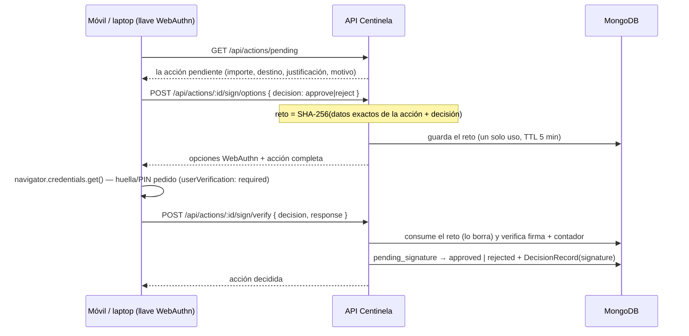

# Fase 4 — La firma con WebAuthn

> Implementación: [`src/auth/`](../src/auth/), página de firma [`/firmar`](../src/auth/firmar.html), demo automática [`scripts/webauthn-demo.ts`](../scripts/webauthn-demo.ts).

## La idea

Cuando el motor decide `sign`, la acción queda pendiente. El humano la firma con su llave WebAuthn (huella del móvil, Windows Hello, llave USB — el "anillo" simulado). **El reto que se firma no es aleatorio: es el hash SHA-256 de los datos exactos de la acción más la decisión.** Firmar = "apruebo ESTE importe, ESTE destino, ESTA justificación". Cualquier cambio produce otro hash y la firma no verifica.

## El flujo



## Endpoints

| Método | Ruta | Qué hace |
|---|---|---|
| `POST` | `/api/webauthn/register/options` | opciones para registrar una llave (usuario demo: `maria`) |
| `POST` | `/api/webauthn/register/verify` | verifica el registro y guarda llave, clave pública y contador |
| `GET` | `/api/webauthn/credentials` | llaves registradas |
| `POST` | `/api/actions/:id/sign/options` | reto de firma = hash(acción + decisión) |
| `POST` | `/api/actions/:id/sign/verify` | verifica la firma y aplica aprobada/rechazada |

## Decisiones de seguridad

1. **El reto es el contenido**: `SHA-256(actionId, tipo, importe, moneda, destino, operación, contentHash, justificación, decisión, firmas previas)` en base64url. No se firma un número aleatorio: se firma *lo que se está aprobando*. Aun así el reto es impredecible, porque `actionId` es un UUID aleatorio que genera el servidor. Si otra persona firma entre el reto y la respuesta, el reto ya no coincide y la firma se rechaza con 409.
2. **Retos de un solo uso**: al verificarlos se borran; una firma no se puede reutilizar aunque sea criptográficamente válida. TTL de 5 minutos.
3. **Contador anti-replay por credencial**: cada firma actualiza el contador del autenticador en MongoDB; un uso con contador antiguo no verifica (defensa estándar contra clones de llave).
4. **`userVerification: required`**: la firma exige huella, PIN o patrón — el "toque humano" del anillo.
5. **`attestation: none`**: para la demo vale cualquier autenticador; en producción se usaría `direct` con MDS para restringir a dispositivos aprobados.
6. **Una firma fallida también consume el reto**: no se puede probar indefinidamente contra un mismo reto; el cliente pide opciones nuevas.
7. **La decisión humana solo existe en la máquina de estados**: `pending_signature → approved | rejected`, aplicada por `applyHumanDecision` con el id de la llave en el `DecisionRecord`.
8. **Lo firmado se ejecuta**: cuando la firma completa el quórum, el conector corre en ese momento y la respuesta incluye `execution`. Dos firmas simultáneas no se pisan: la escritura es condicional y la segunda recibe 409.
9. **Registrar y firmar son rutas de admin**: exigen `CENTINELA_ADMIN_TOKEN` (la página `/firmar` lo pide). Un agente no puede registrar una llave ni firmar. Ver [`docs/11-acceso.md`](11-acceso.md).
10. **RP ID = `localhost`**: la página debe abrirse con `http://localhost:4000` (no 127.0.0.1). En producción sería el dominio real de la empresa.

## Probar

```bash
pnpm dev                        # http://localhost:4000
# en el navegador (móvil o laptop):
open http://localhost:4000/firmar   # registra tu llave una vez
node scripts/smoke.mjs              # propón un pago grande (queda pendiente)
# vuelve a /firmar: aprobar o rechazar con tu huella/PIN
```

Demo sin navegador, con criptografía real:

```bash
node scripts/webauthn-demo.ts
```

## El autenticador virtual (tests y demo)

[`src/auth/testkit.ts`](../src/auth/testkit.ts) implementa un autenticador WebAuthn virtual: genera una clave EC P-256, produce la respuesta de registro (attestation `none`, CBOR construido a mano) y firma de verdad las aserciones con la clave privada. Las pruebas ejercitan así la criptografía completa — reto, origen, contador, firmas — sin depender de un navegador; las mismas rutas funcionan igual con llaves reales.
