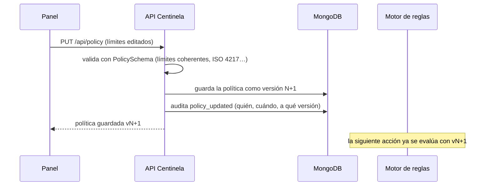

# Fase 6 — El panel de administración

> Implementación: [`src/web/panel.html`](../src/web/panel.html) (servido en `/panel`), endpoints `PUT /api/policy` y `GET /api/stats` en [`src/api/app.ts`](../src/api/app.ts).

## Qué ve una empresa

1. **El libro mayor**: una línea de resumen — asientos, en espera, aprobadas, bloqueadas y estado de la cadena de auditoría.
2. **En espera de firma**: qué pidió cada agente, el motivo del motor y cuándo caduca, con acceso directo a la página de firma.
3. **Reglas de la empresa**: límites en euros por tipo (aprobar automáticamente / exigir firma / bloquear), monedas, destinos de confianza y prohibidos, caducidad de la firma. **Guardar crea una versión nueva** que el motor usa al instante, sin tocar código ni reiniciar nada.
4. **Historial**: filtros por estado, tipo y agente; cada asiento despliega su doble rastro (decisiones embebidas + registro encadenado).
5. **Auditoría**: botón "Verificar cadena" y las últimas entradas del registro.

## Cómo funciona el cambio de política



- La **versión la asigna el servidor** (la anterior + 1): nadie puede sobrescribir una política existente; todas quedan en la base de datos.
- El **cambio queda auditado** como un evento más de la cadena.
- El esquema rechaza configuraciones incoherentes (el umbral de firma debe superar al de aprobación automática).
- Cada decisión del motor registra **con qué versión de política** se tomó.

## Decisiones de diseño de la interfaz

El panel se dibuja como un **libro mayor nocturno**, no como un dashboard genérico: tablas rayadas con doble filete, importes en serif de registro, estados como sellos de tinta (aprobado en verde, bloqueado en bermellón, pendiente en oro) y tinta roja reservada para lo que se frena. Sin tarjetas, sin gradientes, sin animaciones de entrada: el único acento es el sello. Tipografías del sistema (sin dependencias de red): sans para controles, serif para el dinero y el registro, monoespaciada solo para ids y hashes.

## Probar

```bash
pnpm dev                        # http://localhost:4000/panel
node scripts/smoke.mjs          # genera actividad desde un agente
# en el panel: sube el límite de pagos a 600,00 EUR y guarda →
# el mismo pago de 500,00 EUR deja de pedir firma al instante
```

## Endpoints nuevos

| Método | Ruta | Qué hace |
|---|---|---|
| `PUT` | `/api/policy` | guarda una política nueva (validada) y devuelve la versión creada |
| `GET` | `/api/stats` | resumen del libro: acciones por estado/tipo + integridad de la auditoría |
