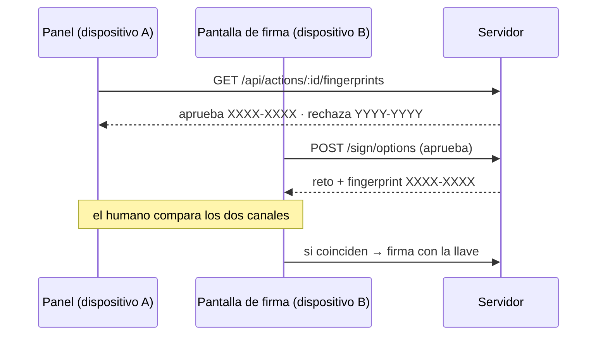

# Más allá de la demo — El canal cruzado (dispositivo infectado)

> Cierra el hueco del dibujo del "ordenador infectado": si la máquina que muestra `/firmar` está comprometida, la UI puede mentirte (mostrar "25,00 €" mientras firmas un reto de 500,00 €). Esta pieza añade un **segundo canal de verificación** y el camino para separar de verdad los dispositivos.

## Qué protege ya la criptografía (incluso en una máquina)

La firma WebAuthn **nunca la fabrica la pantalla**: el reto lo calcula el servidor sobre la acción guardada en MongoDB (`SHA-256` de los datos exactos + la decisión). Un atacante no puede producir una firma válida para otros datos. Lo que SÍ puede hacer una pantalla comprometida es **mentirte sobre lo que muestras**, y eso es exactamente lo que se cierra aquí.

## La huella de verificación entre canales

- El panel (dispositivo A, el de la empresa) muestra, junto a cada pendiente, dos códigos: `aprueba XXXX-XXXX` y `rechaza YYYY-YYY` (`GET /api/actions/:id/fingerprints` — lectura pura, no crea retos).
- La pantalla de firma (dispositivo B, tu móvil) muestra, al pulsar Aprobar/Rechazar, **un solo código** que sale del reto real que estás a punto de firmar (`POST /api/actions/:id/sign/options` → `fingerprint`).
- El humano compara: **si los códigos no coinciden, no firma**. Una pantalla mentirosa no puede inventar el código sin que la comparación falle — porque el código es la huella del reto criptográfico, no un texto de la UI.



## Desplegar la firma en OTRO dispositivo (el móvil)

WebAuthn exige contexto seguro, y `localhost` solo vale en la propia máquina. Para firmar desde el móvil hay dos caminos:

**Camino A — túnel HTTPS (el más rápido para la demo):**

```bash
HOST=0.0.0.0 pnpm dev &
cloudflared tunnel --url http://localhost:4000     # te da https://<algo>.trycloudflare.com
```

Y en la segunda terminal, con el hostname que te dé el túnel:

```bash
RP_ID=<algo>.trycloudflare.com ORIGIN=https://<algo>.trycloudflare.com HOST=0.0.0.0 pnpm dev
```

Abre en el móvil `https://<algo>.trycloudflare.com/firmar` y registra la llave desde el móvil (el RP ID será el dominio del túnel; las llaves registradas con `localhost` no valdrán para el nuevo dominio).

**Camino B — HTTPS propio** (un dominio de verdad, o un proxy inverso con certificado): mismo patrón, `RP_ID` = dominio registrable, `ORIGIN` = su URL HTTPS.

Variables nuevas: `HOST` (por defecto `127.0.0.1`; `0.0.0.0` expone a la red — el servidor avisa por consola). `RP_ID` y `ORIGIN` ya existían.

## Límites honestos

- El código de verificación funciona **incluso en la misma máquina** (compara el panel contra la pantalla de firma), pero su valor real llega cuando los dos canales viven en dispositivos distintos.
- Si el atacante compromete **ambos** dispositivos (o el propio servidor), la comparación ya no salva nada: por eso en producción la pantalla de firma debe ser un servicio separado, con su propio despliegue y superficie mínima — fuera del alcance de esta demo, pero el hueco queda documentado en [`docs/07-ataques.md`](07-ataques.md).
- El cuarto ojos (dos firmas de personas distintas para importes grandes) se construye sobre este cimiento: sin un canal fiable, pedir dos firmas en la misma pantalla mentirosa no añade nada.
